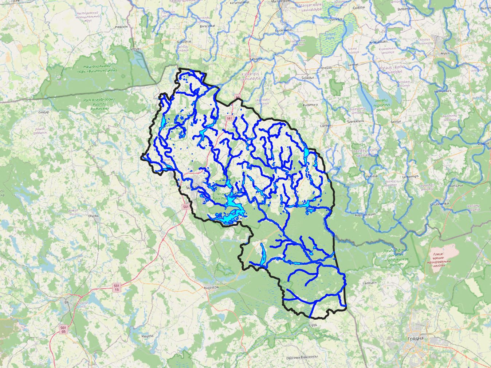

# PLSWAT: River Modeling System for Poland

[](https://www.r-project.org/)
[](https://www.python.org/)
[](https://postgis.net/)
[](https://swat.tamu.edu/software/plus/)

## Table of Contents
- [Project Overview](#project-overview)
- [Repository Structure](#repository-structure)
- [Prerequisites](#prerequisites)
- [Data Directory Structure](#data-directory-structure)
- [Key Functionalities](#key-functionalities)
- [Usage](#usage)
- [Data Population Overview](#data-population-overview)
- [Safety Warning](#-safety-warning)

## Project Overview



**PLSWAT** is a comprehensive river modeling repository designed to automate the generation, population, and execution of **SWAT+** modeling setups for Nemunas basin in Poland (~2000 km²). It is an adaptation of the **LTSWAT** (Lithuanian River Modeling System, [GitHub](https://github.com/biopsichas/LTSWAT) & [Documentation](https://doi.org/10.5281/zenodo.11092543)), using standardized workflows to ensure consistent water quality and quantity modeling — particularly in transboundary catchments.

The repository currently supports **5 SWAT+ model setups** for the following watersheds:

| Watershed | Description |
| --- | --- |
| **Czarna Hańcza Upper** | Upper sub-catchment of the Czarna Hańcza river |
| **Czarna Hańcza Lower** | Lower sub-catchment of the Czarna Hańcza river |
| **Marycha** | Marycha river watershed |
| **Gaładuś Lake** | Gaładuś Lake catchment |
| **Szeszupa** | Szeszupa river watershed |

At the core of the project, `main.R` automates the creation, transformation, and ingestion of spatial and tabular data into a PostgreSQL/PostGIS database required for running SWAT+ models. It processes shapefiles, CSVs, and rasters to ensure the database schema aligns with the project's requirements.

The script acts as an **ETL (Extract, Transform, Load) pipeline**: it connects to a source database (Lithuanian SWAT model parameters) and a target database, mapping and harmonizing data between the two.

## Repository Structure

| Path | Description |
| --- | --- |
| `Data/` | All primary input datasets — Polish-specific geospatial (DEM, soil, land use) and thematic (meteorological, point source) data. Also required as input for `main_GIS_PL.py`, the primary script used to populate the PostgreSQL/PostGIS database. |
| `main.R`, `connect.R`, `function.R` | Core execution logic. These R scripts manage database connections and drive the modeling workflow. |

## Prerequisites

**R environment** with the following packages:

| Package | Purpose |
| --- | --- |
| [`sf`](https://r-spatial.github.io/sf/) | Geospatial data manipulation |
| [`DBI`](https://dbi.r-dbi.org/) | Database connectivity |
| `bit64` | Handling 64-bit integer IDs |
| [`terra`](https://rspatial.github.io/terra/) / [`exactextractr`](https://isciences.gitlab.io/exactextractr/) | Raster processing |
| *custom utilities* | Loaded via `source("connect.R")` |

**Database:** A PostgreSQL instance with the **PostGIS** extension enabled.

## Data Directory Structure

To run `main.R` successfully, organize your `Data/` directory as follows. Each folder holds the shapefiles, rasters, and CSVs required for database ingestion.

```text
📁 PLSWAT/                                        (Main root repository)
├── 📁 Data/                                      (Required input directory for main.R)
│   ├── 📁 AtmosphericDeposition/                 (GeoJSON and precipitation inputs)
│   ├── 📁 BufferZones/                           (Shapefiles for buffer strip analysis)
│   ├── 📁 Catchments/                            (River network / watershed .shp and .csv files)
│   ├── 📁 Counties/                              (Administrative boundaries and raster IDs)
│   ├── 📁 DEM/                                   (Digital Elevation Model files)
│   ├── 📁 Drainage/                              (Managed drainage raster and lookup files)
│   ├── 📁 HRU/                                   (Hydrological Response Units & elevation)
│   ├── 📁 Lakes/                                 (Lake/reservoir spatial and physical data)
│   ├── 📁 LU/                                    (Land use rasters .tif and lookup tables)
│   ├── 📁 Meteo/                                 (Meteorological station and climate data)
│   ├── 📁 Obs/                                   (Observed data for calibration/validation)
│   └── 📁 Soil/                                  (Soil parameter lookup tables)
├── 📄 .gitattributes                             (Git configuration)
├── 📄 .gitignore                                 (File exclusion patterns)
├── 📄 .Renviron                                  (Connection details to PostgreSQL database)
├── 📄 PLSWAT.Rproj                               (R Project file)
├── 📄 connect.R                                  (Database connection scripts)
├── 📄 function.R                                 (Custom utility functions)
└── 📄 main.R                                     (Core ETL processing script)
```

## Key Functionalities

The script performs the following operations sequentially:

1. **Database Connection** — Establishes connections to the source (`lt_con`) and target (`pl_con`) databases.
2. **Spatial Data Processing** — Reads shapefiles, reprojects to **EPSG:2180**, handles geometry, and calculates spatial attributes (centroids, area, etc.).
3. **Table Ingestion** — Loads processed data into the database, defining table constraints (primary keys, geometry types) for:
   - **Catchments & Rivers** — watershed boundaries, river networks, and outlet definitions
   - **Land Use & Soil** — lookup tables connecting raster IDs to SWAT codes
   - **Atmospheric Deposition** — spatial data for precipitation and N/P deposition
   - **HRU & Management** — buffer zones, elevation data, livestock units, and yield calculations

## Usage

1. Ensure your `Data/` directory contains all necessary source files (see [Data Directory Structure](#data-directory-structure)).
2. Verify database credentials in `connect.R`, which should be sourced from `.Renviron` in the same folder.
3. Run `main.R` in an R environment.

> **Tip:** It's recommended to run sections incrementally, or use the commented-out `compare_columns` functions to validate schema compatibility before finalizing writes to the database.

## Data Population Overview

The table below summarizes the source and integration logic for each dataset processed by `main.R`. The script populates the SWAT modeling database (`pl_con`) by harmonizing local spatial/tabular files with parameters inherited from the legacy Lithuanian modeling system (`lt_con`).

**Data source key:**
- **Data folder** — Raw files (shapefiles, CSVs, GeoTIFFs) in the project's local `Data/` directory.
- **Empty dataframe** — Tables initialized as empty placeholders for future modeling runs or user-defined inputs.
- **`lt_con`** — Tables fetched directly from the legacy Lithuanian SWAT database, providing baseline parameters and model constants.

| Table Name | Schema | Population Source | Status |
| --- | --- | --- | --- |
| `catchments` | `catchments` | Data folder (`Catchments/WatershedsPL_corrected2.shp`) | ✅ Filled |
| `riversegments` | `catchments` | Data folder (`Catchments/RiversPLcorrected.shp`) | ✅ Filled |
| `outlets` | `catchments` | Data folder (`Catchments/outlets.csv`) | ✅ Filled |
| `watersheds` | `catchments` | Data folder (`Catchments/watersheds.csv`) | ✅ Filled |
| `catchm_wshed` | `catchments` | Data folder (`Catchments/catchm_wshed.csv`) | ✅ Filled |
| `watertransfer` | `catchments` | Empty dataframe | ⬜ Empty |
| `landuse_swat_raster_lookup` | `landuse` | Data folder (`LU/lookup.csv`) | ✅ Filled |
| `landusegroup_raster_lookup` | `landuse` | Hardcoded (7 land use classes) | ✅ Filled |
| `soil_swat_raster_lookup` | `soil` | Data folder (`Soil/Lookup_soil.csv`) | ✅ Filled |
| `usersoilpl` | `swat2012` | Data folder (`Soil/Lookup_soil.csv`) | ✅ Filled |
| `drainage_raster_lookup` | `mel_dr10lt` | Hardcoded (2 drainage codes: `hm0`, `hm0g`) | ✅ Filled |
| `atmdep2022` | `atm_deposition` | Data folder (`AtmosphericDeposition/AtmDep2022.geojson`) | ✅ Filled |
| `buffzones_stat` | `hru` | Data folder (`BufferZones/bufferstrips.shp`) | ✅ Filled |
| `node_elevation` | `hru` | Data folder (`HRU/node_elevation.shp`) | ✅ Filled |
| `fertcoefbycatchm` | `hru` | Computed from `catchments` table (fertcoeff = 1) | ✅ Filled |
| `lakesreservoirs` | `hru` | Data folder (`Lakes/lakesReserv.shp`) | ✅ Filled |
| `precip_by_catch` | `hru` | Data folder (`Meteo/pcp_avg1997_2020.tif`) | ✅ Filled |
| `catchments_regions` | `hru` | Empty dataframe | ⬜ Empty |
| `counties_raster_lookup` | `counties` | Data folder (`Counties/counties.shp`) | ✅ Filled |
| `counties` | `counties` | Data folder (`Counties/counties.shp`) | ✅ Filled |
| `polygons` | `bufferstrips` | Data folder (`BufferZones/bufferstrips.shp`) | ✅ Filled |
| `plant_data` | `fert` | `lt_con` | ✅ Filled |
| `plants_luclass` | `fert` | `lt_con` | ✅ Filled |
| `forest_biomass` | `fert` | `lt_con` | ✅ Filled |
| `lup_table1` | `lup` | Data folder (`LU/lugroups.tif`) + `lt_con` | ✅ Filled |
| `lup_table2` | `lup` | Data folder (`LU/lugroups.tif`) + `lt_con` | ✅ Filled |
| `gri_water_catchments` | `rivers` | Empty dataframe | ⬜ Empty |
| `segment_depth` | `rivers` | Empty dataframe | ⬜ Empty |
| `segmentmanningcoef` | `rivers` | Empty dataframe | ⬜ Empty |
| `statpcp` | `obs` | Weather data + `lt_con` | ✅ Filled |
| `ps_catchment` | `point_sources_zero` | Empty dataframe | ⬜ Empty |
| `small_catch` | `point_sources_zero` | Empty dataframe | ⬜ Empty |
| `plantmng` | `management` | `lt_con` | ✅ Filled |
| `plant_plt` | `management` | `lt_con` | ✅ Filled |
| `urban_urb` | `management` | `lt_con` | ✅ Filled |
| `cntable_lum` | `management` | `lt_con` | ✅ Filled |
| `landuse_properties` | `management` | `lt_con` | ✅ Filled |
| `livestock_data` | `management` | Data folder (`LU/lugroups.tif`) + `Counties/counties.shp` | ✅ Filled |
| `yield_data` | `management` | `lt_con` + Data folder (`Counties/counties.shp`) | ✅ Filled |

## ⚠️ Safety Warning

The script contains commands such as `DBI::dbRemoveTable`, which **permanently delete data** from the target database schema. Exercise caution when running these — double-check the target connection (`pl_con` vs. `lt_con`) and consider taking a database backup before executing destructive operations.
